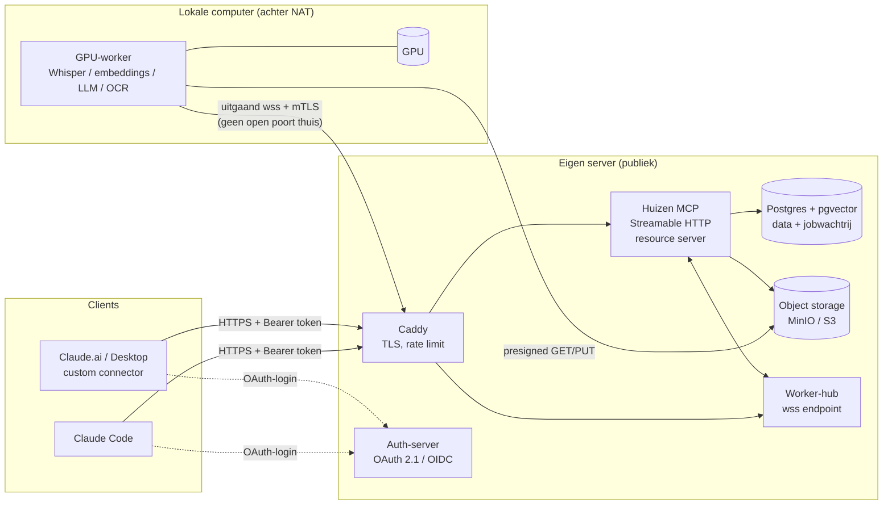

# Voorstel: publicatie van de Huizen MCP op de eigen server, met de GPU lokaal

*Status: voorstel, ter bespreking · 2026-10-09*

## 0. Uitgangspunt en kanttekening

De broncode van de Huizen MCP zat niet in de repo's die ik in deze sessie kon bekijken. Ik heb het
tool-oppervlak daarom afgeleid uit de skills die de MCP gebruiken (`council-video-clips`,
`raads-voorbereiding`, `raads-verslag`). Voor het ontwerp maakt dat weinig uit, want dat hangt af van
*welk soort werk* elke tool doet. Wel moet de indeling in §1 nog worden gecontroleerd met de code
(zie §10, open vragen).

De harde eisen:

1. De MCP draait publiek bereikbaar op jouw server.
2. De GPU (Whisper, embeddings, eventuele LLM's en PDF/OCR-modellen) blijft op je lokale computer.
3. Werk dat de GPU nodig heeft, gaat naar die lokale computer. Het resultaat komt terug naar de server.
4. Autorisatie en beveiliging moeten op orde zijn, want de server staat open op internet.

---

## 1. Indeling van de tools: wat draait waar

| Categorie | Tools (afgeleid) | Waar draaien |
|---|---|---|
| **A. Licht, alleen CPU/DB** | `ris_browse_meetings`, `ris_get_meeting_documents`, `ris_get_document_info`, `list_meetings`, `search_meetings`, `list_council_members`, `sync_meeting_agenda`, `set_agenda_item_section`, `set_video_chapters`, `set_meeting_video_embed_info`, `list_pending_meeting_videos`, `review_meeting_video`, `approve_meeting_video`, `reject_meeting_video`, alle `get_*_result` | **Server** |
| **B. GPU-zwaar, asynchroon** | `start_transcription_and_index` (Whisper + embeddings), `start_pdf_conversion_and_index` (bij OCR/layout-model + embeddings) | **Lokale GPU-worker** via de wachtrij |
| **C. GPU, kort/synchroon** | Query-embedding binnen `search_documents`, eventuele LLM-aanroepen | Zie §4.3: embedding op de server-CPU, LLM via een synchrone dispatch |
| **D. Bestanden en externe diensten** | `start_ingest_audio` (ffmpeg, audio-extractie), `ris_download_docs`, `start_publish_meeting_video` (ffmpeg-knippen + YouTube-upload) | **Server** (CPU), met de bestanden in object storage |

Een belangrijk inzicht: **de bestaande `start_*` / `get_*_result`-polling past hier precies bij.**
Een `start_*`-call zet nu een job in de wachtrij in plaats van een lokale thread te starten. Voor
de MCP-client (Claude) verandert er niets aan de werkwijze.

---

## 2. Aanbevolen architectuur



### Kernkeuze: de worker maakt zelf verbinding (pull), de server belt nooit naar huis

De lokale GPU-worker zet **zelf een uitgaande verbinding** op naar de server (WebSocket over TLS,
met mTLS). Via die verbinding krijgt hij jobs binnen en meldt hij resultaten terug. De server opent
nooit een verbinding naar je thuisnetwerk.

Waarom dit de beste optie is:

- **Geen open poorten thuis.** Je thuis-IP blijft verborgen. Dit werkt ook achter NAT of CGNAT en op
  een wisselend IP-adres.
- **De worker hoeft niet aan te staan.** Staat de pc uit, dan blijven jobs veilig in de wachtrij
  staan en worden ze verwerkt zodra de worker weer verbinding maakt. Bij een push-model zouden ze
  mislukken.
- **De worker begrenst zelf de belasting.** Hij haalt maar zoveel jobs op als de GPU aankan, dus
  normaal één tegelijk.
- **Een gecompromitteerde server kan weinig met je thuismachine.** De server kan alleen jobs
  aanbieden van vooraf toegestane types. Hij kan geen willekeurige endpoints thuis aanroepen.

**Overwogen en afgewezen als primaire optie:** een WireGuard- of Tailscale-tunnel waarbij de server
een lokale API (bijvoorbeeld Ollama of een Whisper-server) direct aanroept. Dat is sneller te bouwen,
maar dan staat er een inbound service open op je thuismachine. Verzoeken mislukken als de pc uit
staat, en je moet zelf retries en wachtrijen bouwen. Tailscale blijft wel een goede **extra laag**
voor beheer, zoals SSH naar de server en het beheerpaneel van MinIO/Postgres zonder publieke poorten.

---

## 3. Componenten op de server

Alles via `docker compose`, elke container als non-root:

| Component | Rol | Opmerking |
|---|---|---|
| **Caddy** | TLS (Let's Encrypt), reverse proxy, rate limiting, request-size limits | Publiek zijn alleen 443 en 80 (redirect) open |
| **Huizen MCP (gateway)** | MCP via **Streamable HTTP** (niet stdio of SSE), valideert tokens, voert de lichte tools uit en zet GPU-jobs in de wachtrij | Bestaande code, met de transport- en auth-laag erbij |
| **Worker-hub** | WebSocket-endpoint voor GPU-workers, deelt jobs uit (lease) en ontvangt resultaten | Kan in hetzelfde proces als de gateway draaien, op een apart pad |
| **Postgres + pgvector** | Alle data (vergaderingen, transcripts, secties, video's, embeddings) **én** de jobwachtrij | Wachtrij via `SELECT … FOR UPDATE SKIP LOCKED`. Redis is niet nodig |
| **MinIO** (of S3-compatibele opslag bij je hoster) | Video's, audio, PDF's, Markdown, geknipte clips | Alleen bereikbaar via presigned URL's met korte geldigheid |
| **Auth-server** | OAuth 2.1 / OIDC (bijvoorbeeld **Authentik**, Keycloak of Zitadel, self-hosted; of Auth0/WorkOS) | Zie §5 |

De data verhuist van de lokale machine (`<repo>/data/...`) naar de server. **De server wordt de
bron van waarheid.** De worker heeft geen eigen state, alleen een cache met modellen.

---

## 4. Het dispatch-protocol: server ↔ lokale GPU

### 4.1 Jobmodel (Postgres-tabel `jobs`)

```
id (uuid) · type ('transcribe' | 'embed_document' | 'pdf_convert' | 'llm_generate' …)
status ('queued' | 'leased' | 'running' | 'succeeded' | 'failed' | 'dead')
payload (jsonb, alleen referenties: object-keys, meeting_id, modelnaam, geen ruwe bestanden)
result (jsonb) · error · attempts · max_attempts
lease_owner · lease_expires_at · progress (0-100) · created_by (gebruiker) · created_at …
idempotency_key (bv. sha256(audio) + model + versie)
```

### 4.2 Verloop van een asynchrone GPU-job (bijvoorbeeld transcriptie)

1. `start_transcription_and_index(meeting_id)` → de gateway controleert de rechten, maakt een job
   aan (`queued`) en geeft direct een `job_id` terug.
2. De worker is verbonden via `wss://…/worker` en meldt zijn **capabilities**, bijvoorbeeld
   `{whisper:large-v3, embed:bge-m3, llm:qwen2.5-14b, ocr:docling}`. De hub geeft alleen jobs uit
   die bij die capabilities passen.
3. De worker krijgt een **lease** (bijvoorbeeld 2 minuten) en verlengt die met een heartbeat. Valt
   de worker weg, dan verloopt de lease en gaat de job terug naar `queued`.
4. Voor de invoer krijgt de worker een **presigned GET-URL** die maar kort geldig is. Na verwerking
   uploadt hij het resultaat via een **presigned PUT** (grote output) of als JSON in het
   resultaatbericht (kleine output).
5. De worker meldt `succeeded` met het resultaat. De server **valideert het resultaat tegen een
   schema** (types, groottes, aantallen) en schrijft het pas daarna weg (secties, segmenten,
   embeddings).
6. `get_transcription_indexing_result(job_id, wait_seconds)` blijft werken zoals nu, maar geeft nu
   ook nuttige statussen terug:
   - `queued`, met de positie in de wachtrij en `gpu_worker_online: false/true`
   - `running`, met de voortgang
   - `succeeded` / `failed`, met de foutmelding

Retries gebeuren met exponentiële backoff. Na `max_attempts` gaat een job naar `dead` en is hij
zichtbaar in een beheertool. Dankzij de idempotency-key wordt dezelfde audio met hetzelfde model
nooit twee keer getranscribeerd.

### 4.3 Korte en synchrone GPU-werk

- **Query-embeddings voor `search_documents`:** draai **hetzelfde embeddingmodel op de CPU van de
  server**. Eén embedding van een korte zoekvraag kost op de CPU maar tientallen milliseconden. Zo
  blijft zoeken werken als de pc uit staat. Gebruik exact hetzelfde model en dezelfde versie als
  bij het indexeren. Sla `embedding_model` op bij elke vector en weiger een mismatch.
- **LLM-aanroepen binnen een tool (als die er zijn):** de gateway zet een job met hoge prioriteit in
  de wachtrij en wacht maximaal ongeveer 25 seconden op het resultaat via dezelfde
  WebSocket-verbinding. Is het dan nog niet klaar, dan geeft de tool een `job_id` terug en schakelt
  hij over op het `get_*_result`-patroon. Staat de worker offline, dan meldt de tool dat direct en
  laat hij de client niet hangen.

### 4.4 Grote bestanden: de video gaat niet heen en weer

- **Upload:** nieuwe tool `create_upload(kind='meeting_video', filename, size, sha256)` → presigned
  PUT-URL (multipart). De client of browser uploadt direct naar object storage.
  `start_ingest_audio(upload_id, meeting_id)` vervangt de huidige `file_path`-parameter.
- **De server extraheert de audio** met ffmpeg op de CPU, naar 16 kHz mono FLAC/Opus. Dat is enkele
  tientallen MB in plaats van GB's. **Alleen die audio** gaat naar de GPU-worker.
- **Knippen en YouTube-upload** (`start_publish_meeting_video`) gebeuren op de server vanuit het
  originele bestand in object storage. De YouTube-credentials staan dan alleen op de server.
- **Optionele snelle route:** als de video toch al thuis staat (je downloadt hem met de browser), kan
  een klein lokaal CLI-commando `huizen-upload <bestand> --meeting 1259` de upload doen, met
  hervatten bij onderbreking. De Anubis-regel uit de skill blijft gelden: **de server haalt zelf
  nooit video's van de RIS-site op.**

---

## 5. Autorisatie

### 5.1 Clients → MCP-server (gebruikers)

Volg de **MCP Authorization-specificatie** (OAuth 2.1). Dat is ook wat Claude.ai en Claude Desktop
verwachten van een remote custom connector:

- De MCP-server is een **OAuth 2.1 resource server** en publiceert **Protected Resource Metadata**
  (RFC 9728) op `/.well-known/oauth-protected-resource`. Die verwijst naar de auth-server.
- De auth-server ondersteunt **Authorization Code + PKCE** en (voor Claude.ai) **Dynamic Client
  Registration**, of een vooraf geregistreerde client.
- De MCP-server valideert bij elke request:
  - de handtekening (JWKS)
  - `iss`
  - **`aud` = deze MCP-server** (resource indicator, RFC 8707)
  - `exp`
  - de scopes

  Tokens doorsturen naar andere diensten (*token passthrough*) is verboden. De MCP-server gebruikt
  eigen credentials voor RIS en YouTube.
- **Wie mag inloggen:** alleen een allowlist van accounts (jijzelf, eventueel fractieleden).
  Self-registratie staat uit en **MFA/passkeys** zijn verplicht in de auth-server.
- Access tokens zijn kort geldig (5-15 minuten). Refresh tokens worden bij elk gebruik vervangen
  (rotation).

### 5.2 Scopes en rollen

| Scope | Tools | Rol |
|---|---|---|
| `huizen:read` | browse, search, list, `get_*_result`, transcripts lezen | lid |
| `huizen:process` | `create_upload`, `start_ingest_audio`, `start_transcription_and_index`, `start_pdf_conversion_and_index`, `ris_download_docs`, `sync_meeting_agenda` | redacteur |
| `huizen:curate` | `set_agenda_item_section`, `set_video_chapters`, `set_meeting_video_embed_info`, `review_/approve_/reject_meeting_video` | redacteur |
| `huizen:publish` | `start_publish_meeting_video`, `update_published_video_description` | **alleen beheerder** |
| `huizen:admin` | worker-beheer, dead-letter-jobs, gebruikers | beheerder |

Publiceren naar YouTube is een handeling naar buiten toe. Daarom:

- Afdwingen **op de server** (niet alleen in de skill) dat `review_status == 'approved'`.
- Goedkeuring vastleggen met wie en wanneer.
- Optioneel een tweede persoon laten goedkeuren (vier-ogenprincipe).

Een tool die ontbreekt in de scopes van een token, verschijnt niet in `tools/list`. Een aanroep
ervan geeft `403 insufficient_scope`.

### 5.3 GPU-worker → server (machine-identiteit)

- **mTLS:** de worker heeft een eigen clientcertificaat, uitgegeven door een kleine eigen CA (bijv.
  `step-ca` of handmatig met `openssl`). Caddy controleert het certificaat op het pad `/worker`.
  Daarbovenop komt een **kortlevend JWT**, ondertekend met de private key van de worker. Zo is
  intrekken per worker mogelijk.
- **Minimale rechten:** de worker kan alleen jobs claimen van zijn eigen types, voortgang melden en
  resultaten indienen. Hij heeft **geen toegang tot MCP-tools**, de database of andere jobs.
  Presigned URL's gelden per object en zijn kort geldig.
- **Andersom:** de worker vertrouwt alleen het servercertificaat, door de CA of het certificaat te
  pinnen. Hij voert alleen **vaste jobtypes** uit met parameters die zijn gevalideerd tegen een
  schema. Er komen nooit shell-commando's of code uit een payload, en modelnamen komen alleen uit
  een lokale allowlist. Zo kan een gecompromitteerde server je thuismachine niet overnemen.

---

## 6. Beveiliging (verder dan auth)

**Aanpassingen aan de code die nodig zijn voor publiek gebruik:**

- **Weg met `file_path`, `pdf_path` en `output_dir` als parameters.** Een publieke server die
  willekeurige lokale paden leest of schrijft, is een kritieke kwetsbaarheid (path traversal,
  bestanden lezen). Vervang ze door `upload_id` / `document_id` en object-keys die de server zelf
  aanmaakt.
- **SSRF:** `ris_download_docs(download_urls)` alleen laten werken voor een **allowlist van hosts**
  (`ris.gemeenteraadhuizen.nl` en wat de RIS-API echt gebruikt). Alleen HTTPS, geen redirects naar
  andere hosts, geen interne IP's, met limieten op grootte en tijd.
- **Validatie van invoer** op elke tool (Pydantic/Zod-schema's), met limieten op `wait_seconds`,
  lengtes en aantallen.
- **Uploads:** controleer MIME-type en magic bytes. ffmpeg en PDF-tools draaien in een container
  zonder netwerk, met CPU-, geheugen- en tijdlimieten (bestanden van buiten zijn onbetrouwbaar en
  ffmpeg is een groot aanvalsoppervlak).
- **Prompt injection:** de teksten van RIS-documenten en transcripties zijn data, geen instructies.
  Geef ze in toolresultaten herkenbaar gemarkeerd terug. Gevaarlijke acties (publiceren) vereisen
  altijd een expliciete goedkeuring die op de server wordt vastgelegd (zie §5.2).

**Infrastructuur:**

- Firewall (ufw/nftables): alleen 443 en 80 publiek. SSH alleen met keys, liefst alleen via
  Tailscale. Verder fail2ban/CrowdSec en automatische security-updates.
- Postgres, MinIO en de beheerpanelen zijn **niet** publiek. Ze zijn alleen bereikbaar binnen het
  docker-netwerk of via Tailscale.
- Rate limiting per gebruiker en per IP in Caddy. Daarnaast een quotum op GPU-jobs per gebruiker
  per dag.
- **Secrets** (YouTube-refreshtoken, RIS-sleutels, DB-wachtwoorden, CA-sleutel) niet in een `.env`
  in git. Gebruik docker secrets of `sops`/`age`, vervang ze regelmatig en houd de CA-sleutel
  offline.
- **Auditlog:** wie heeft welke tool aangeroepen met welke parameters, met extra aandacht voor
  `approve_*` en `publish_*`.
- **Back-ups:** dagelijks `pg_dump` en een MinIO-replicatie, versleuteld en buiten de server
  opgeslagen (bijvoorbeeld restic naar een andere locatie). Test het terugzetten ook.

**Privacy (AVG):** transcripties en sprekersherkenning bevatten persoonsgegevens van raadsleden en
insprekers. De vergaderingen zijn openbaar, maar een doorzoekbare en verrijkte dataset is een nieuwe
verwerking. Daarom:

- toegang alleen voor geautoriseerde gebruikers
- een bewaartermijn voor ruwe video en audio (bijvoorbeeld verwijderen na publicatie plus 90 dagen)
- een server in de EU
- een korte verwerkingsnotitie

---

## 7. De lokale GPU-worker

- Een Docker-container met de NVIDIA-runtime (of een Python-service met systemd of een
  Windows-service). Hij start automatisch en maakt opnieuw verbinding met backoff.
- **Capability-registry:** in een configuratiebestand staat welke modellen hij aanbiedt. De
  modellen worden lokaal gecachet (Hugging Face-cache, Ollama).
- **Concurrency per GPU:** standaard één zware job tegelijk. Kleine embedding-jobs kunnen ertussen
  worden geschoven als er genoeg VRAM is.
- **"Pauzeren"-knop:** handig als je de GPU zelf nodig hebt, bijvoorbeeld om te gamen of voor
  ander werk. De worker meldt dan `paused` en jobs blijven in de wachtrij staan.
- **Optioneel:** de server stuurt een **Wake-on-LAN** via Tailscale/een thuisrouter als er jobs
  wachten en de worker offline is. Een tool `worker_status` laat zien of de GPU online is, welke
  modellen beschikbaar zijn en hoe lang de wachtrij is.

---

## 8. Migratieplan

| Fase | Inhoud | Resultaat |
|---|---|---|
| **1. Ontkoppelen** (lokaal) | Splits de code in `gateway` (tools) en `worker` (GPU-taken) met de wachtrij in Postgres. Vervang `file_path`/`pdf_path` door uploads en object-keys. Beide draaien nog op je eigen pc. | Zelfde functionaliteit, nieuwe interne structuur |
| **2. Server-infra** | Zet Caddy, Postgres+pgvector, MinIO en de auth-server op met compose. Zet back-ups en firewall direct goed. Migreer de bestaande data uit `data/` en de lokale DB. | Lege maar beveiligde omgeving |
| **3. Gateway naar de server** | Streamable HTTP plus OAuth (resource server en metadata), scopes per tool en het auditlog. Test eerst met Claude Code (`claude mcp add --transport http …`), daarna als custom connector in Claude.ai. | MCP is publiek bereikbaar, de lichte tools werken |
| **4. Worker koppelen** | wss en mTLS, leases en heartbeats, presigned I/O, validatie van resultaten. Test ook: pc uit tijdens een job, opnieuw verbinden, dubbele jobs. | De GPU-pipeline werkt end-to-end |
| **5. Publicatie** | YouTube-credentials naar de server, goedkeuring server-side afdwingen, alleen beheerders mogen publiceren. | Volledige pipeline uit de skill werkt remote |
| **6. Skills bijwerken** | Pas `council-video-clips` en `raads-voorbereiding` aan: `upload_id` in plaats van `file_path`, en de statussen `queued`/`gpu_worker_online`. | Skills en server lopen gelijk |

---

## 9. Kosten en eisen aan de server

Er is geen GPU nodig op de server. Een VPS met **4 vCPU, 8 GB RAM** en genoeg schijf of goedkope
object storage voor de video's volstaat: ffmpeg voor audio-extractie en knippen,
CPU-query-embeddings en Postgres. Video's van ongeveer 1-3 GB per vergadering nemen het meeste
ruimte in. Met een bewaartermijn (§6) blijft dat beperkt.

---

## 10. Open vragen (nodig om het voorstel definitief te maken)

1. **Waar staat de code van de Huizen MCP?** Ik heb hem niet in je GitHub-repo's gevonden. Als je
   hem toevoegt, controleer ik de indeling uit §1 en maak ik een concreet implementatieplan per
   bestand.
2. Welke modellen draaien er precies op de GPU (Whisper-variant, embeddingmodel, LLM via Ollama,
   OCR/docling)? En zit er nu ergens een LLM in een tool die **synchroon** een antwoord moet geven?
3. Wie gaan de MCP gebruiken: alleen jij, of ook fractieleden? Dat bepaalt de keuze voor de
   auth-server (self-hosted Authentik tegenover een beheerde dienst) en de rollen.
4. Welke server (OS, specificaties, hoster, EU?) en is er een domeinnaam beschikbaar?
5. Draait je lokale computer op Windows of Linux? Dat bepaalt hoe de worker als service draait en
   of Wake-on-LAN mogelijk is.
